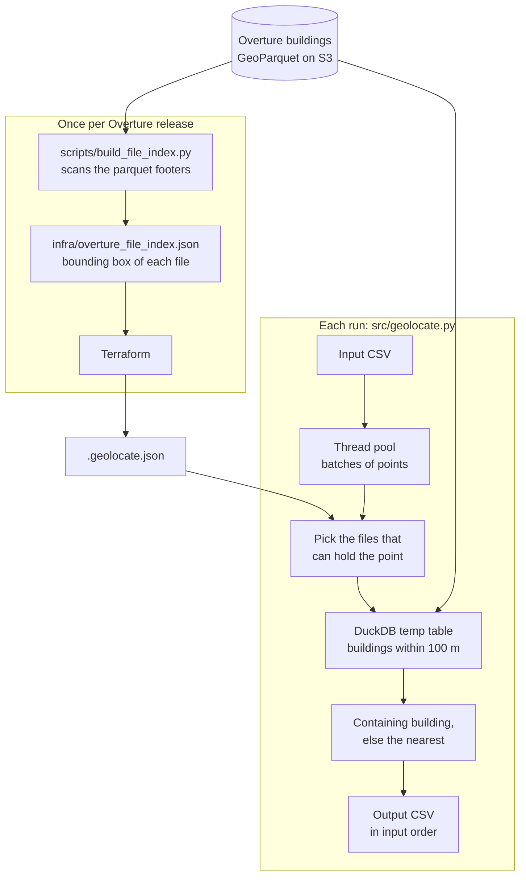

# geolocate

Match `(id, lat, lon)` points to the [Overture Maps](https://overturemaps.org) building they fall
in, or the nearest building within 100 m, anywhere in the world. It reads Overture's public
GeoParquet on S3 with DuckDB, so no AWS account is needed.

| id | lat | lon | match_type | distance_m | name | class |
|---|---|---|---|---|---|---|
| empire | 40.7484 | -73.9857 | `intersects` | 0.0 | Empire State Building | office |
| sol | 40.4169 | -3.7035 | `nearest` | 33.82 | Presidencia de la Comunidad de Madrid | government |
| ocean | 0.0 | -30.0 | `none` | | | |

## Architecture



The stored index means a point reads only the parquet files that can contain it, instead of
scanning all of them. On a 4-core, 4 GB machine, 500 points around 20 cities took about 30 seconds.

## Quick start

You need Docker, [Terraform](https://developer.hashicorp.com/terraform/install) ≥ 1.3 (or
OpenTofu) and network access to S3 (`us-west-2`).

```bash
git clone https://github.com/mnovovil/geolocate.git && cd geolocate
terraform -chdir=infra init && terraform -chdir=infra apply   # writes .geolocate.json
docker build -f docker/Dockerfile -t geolocate .
```

Put your points in a CSV with the columns `id`, `lat`, `lon`, and run it from the repo root:

```bash
docker run --rm --user "$(id -u):$(id -g)" \
  -v "$PWD/.geolocate.json:/config/.geolocate.json:ro" \
  -v "$PWD:/data" \
  geolocate my-points.csv                   # -> ./my-points_geolocated.csv
```

Without Docker (Python ≥ 3.10), after the Terraform step:

```bash
uv venv .venv && uv pip install -p .venv -r requirements.txt   # or python3 -m venv and pip
.venv/bin/python src/geolocate.py my-points.csv
```

Overture removes old releases roughly monthly, so the pinned one eventually stops working. See
[Changing the Overture release](docs/reference.md#changing-the-overture-release). Output columns,
flags, limitations and development commands are all in the [reference](docs/reference.md).
